<h1 align="center"></h1>

<b>See what your team is changing <i>before</i> anyone commits, pushes or merges.</b>

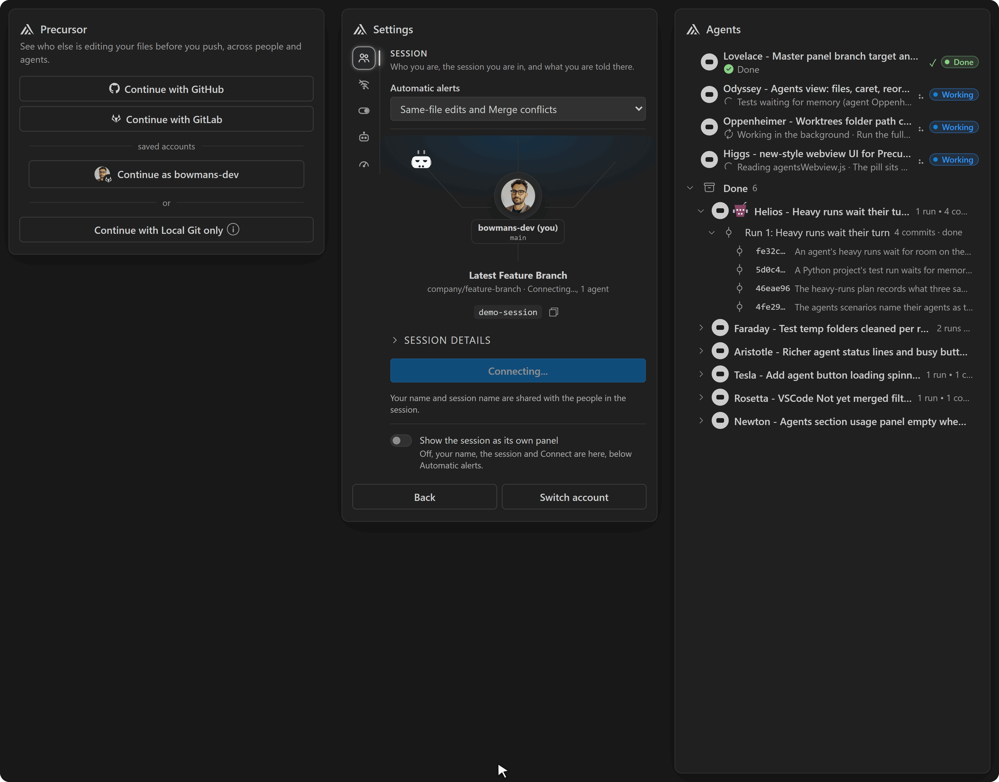

<a href="#privacy-what-leaves-your-machine">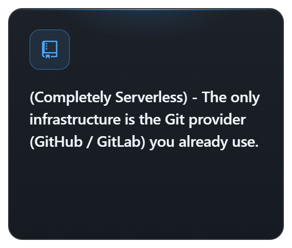</a><a href="#three-ways-to-use-it">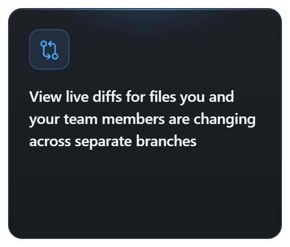</a><a href="#how-it-works-for-the-curious">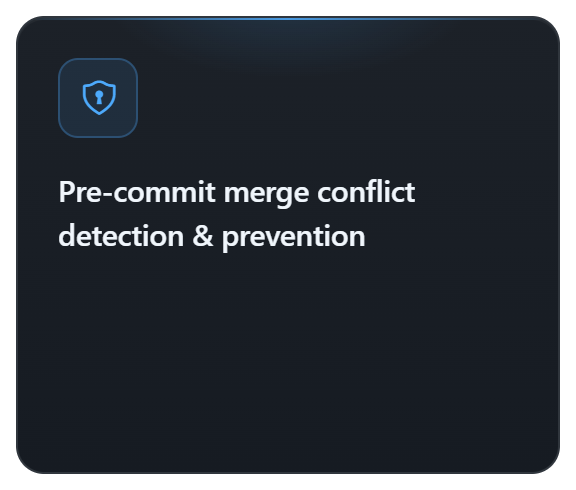</a><a href="#three-ways-to-use-it">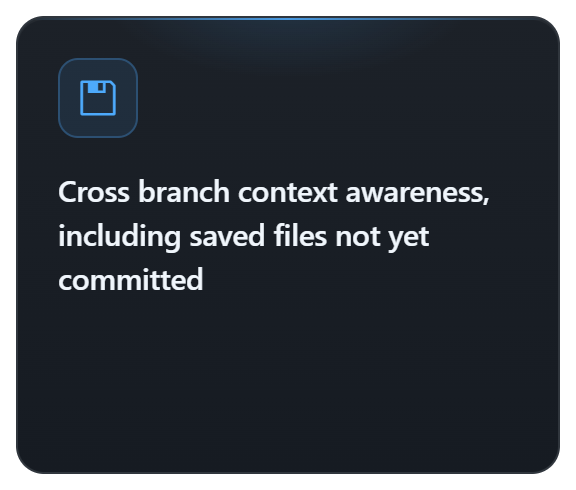</a><a href="#coding-agents">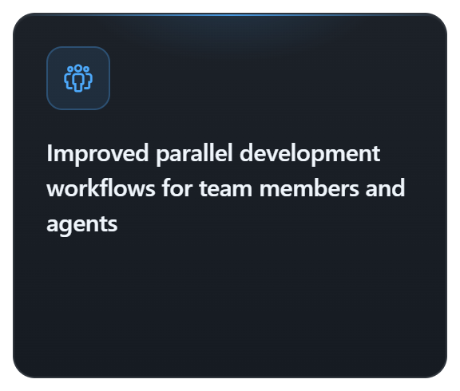</a><a href="#what-makes-it-different">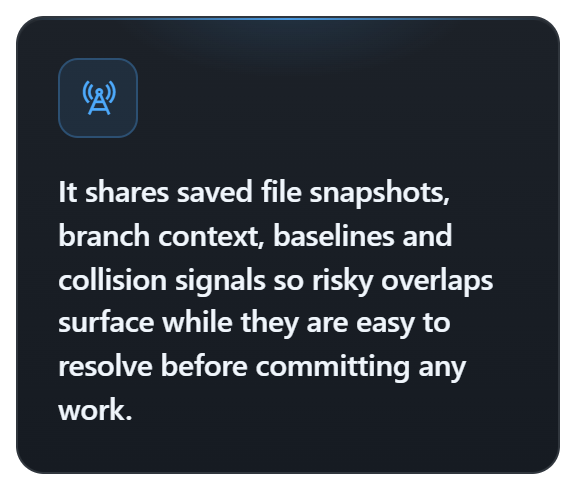</a>

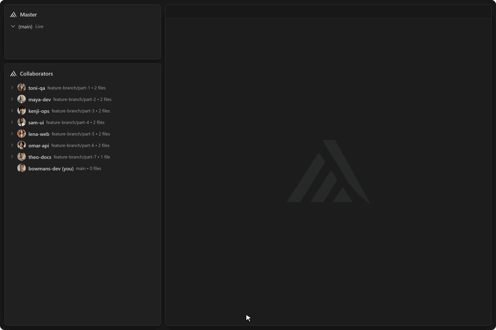

---

<h2 align="center">Why Precursor</h2>

  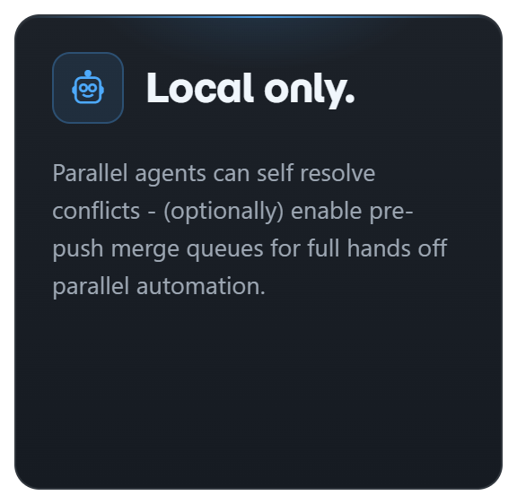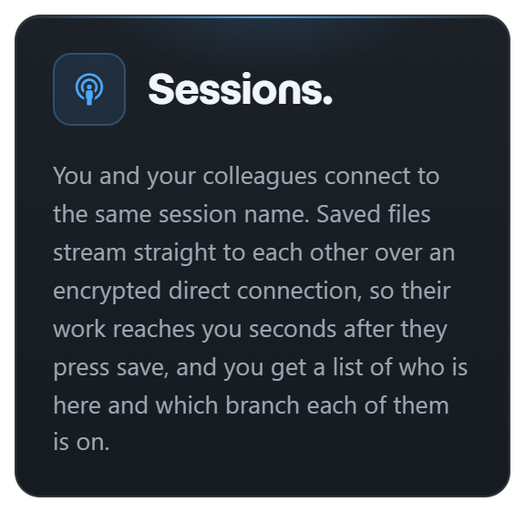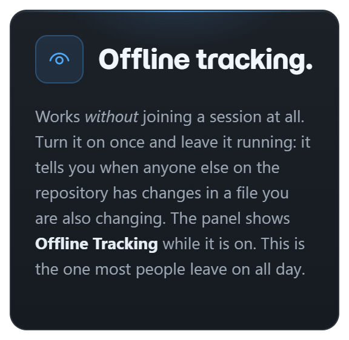

